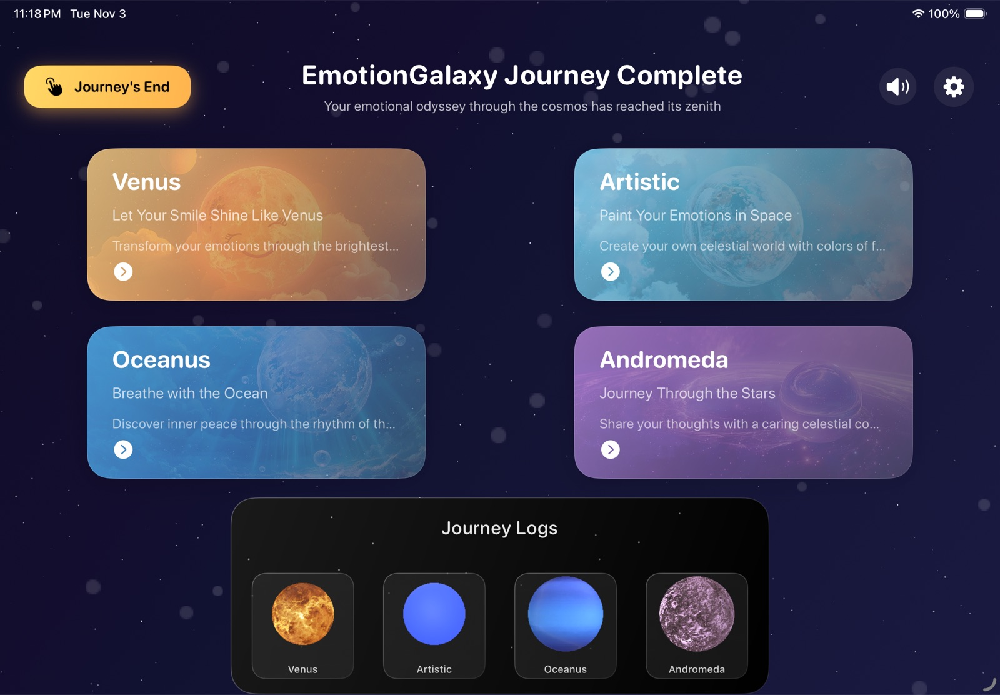
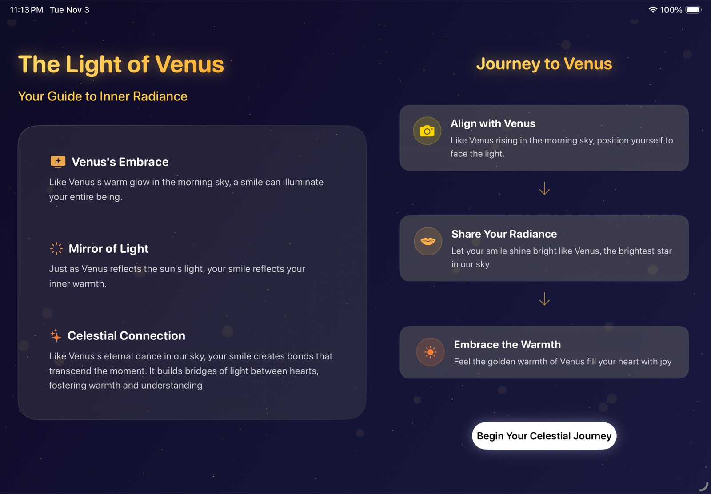
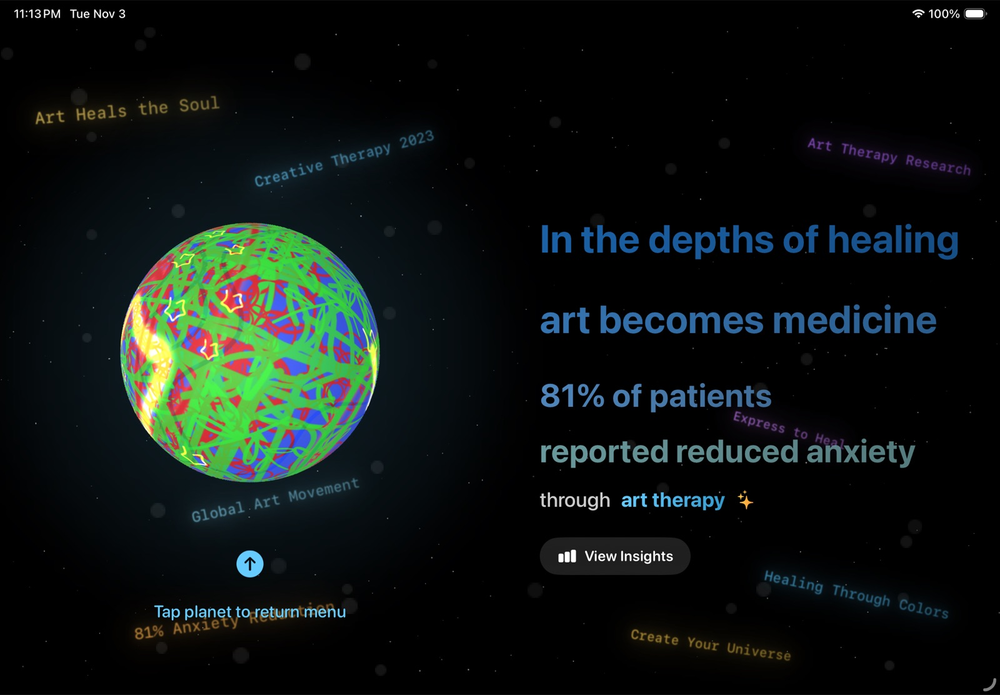
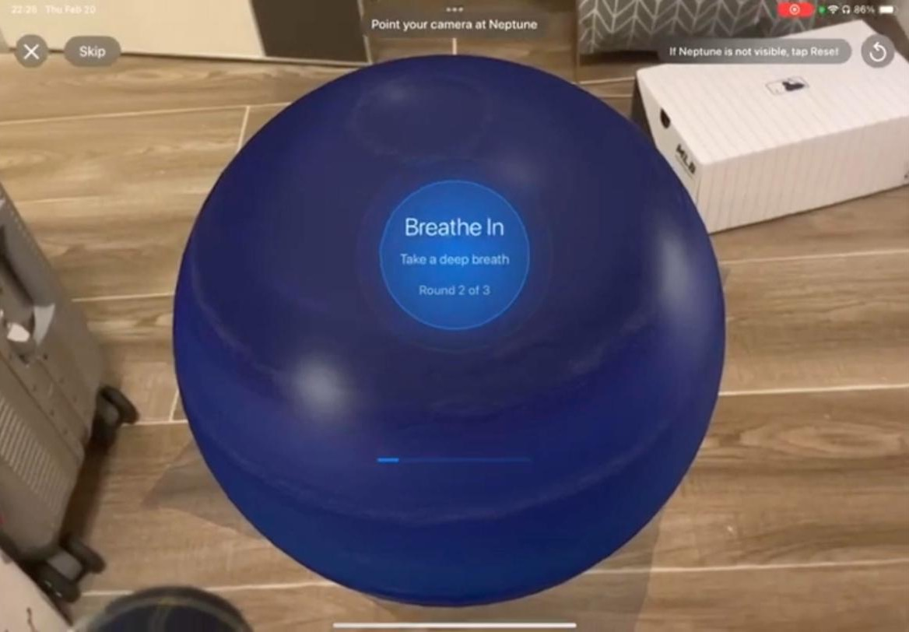
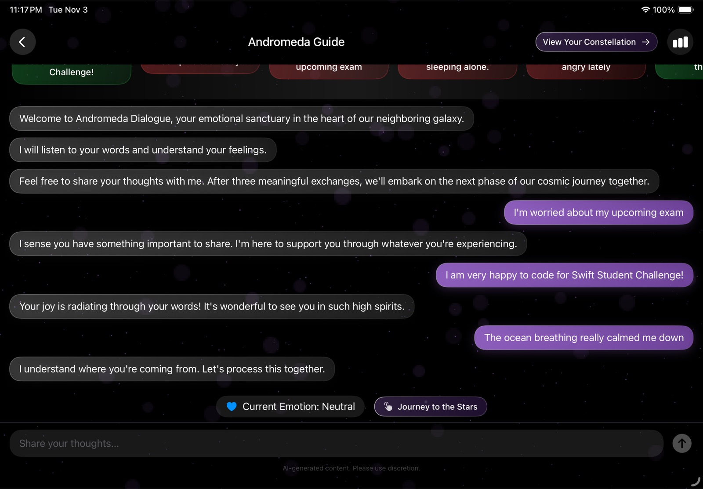

<h1>Emotion Galaxy</h1>

<b>A journey through four planets, each one a small practice for your mental health.</b>

<a href="https://apps.apple.com/app/emotiongalaxy/id6744534726"><b>App Store</b></a>
&nbsp;·&nbsp;
<a href="https://www.youtube.com/watch?v=_qZ94zRjrqs"><b>Demo video</b></a>
&nbsp;·&nbsp;
<a href="https://randyxian.com/blog/emotion-galaxy"><b>Write-up</b></a>

 

Feelings are hard to talk about because they have no shape. Planets have one.

Emotion Galaxy turns four practices that therapists use into four planets you visit in order. Each planet runs on
the Apple framework that makes its practice possible, and finishing one unlocks the next, so the whole thing plays
like a short game with an ending.

## Planets

<table>
<tr>
<td width="50%" valign="top">  <b>Venus</b>: smile and hold it for two seconds. Vision · AVFoundation</td>
<td width="50%" valign="top">  <b>Artistic</b>: four drawings become the surface of your own planet. PencilKit · Create ML · SceneKit</td>
</tr>
<tr>
<td width="50%" valign="top">  <b>Oceanus</b>: Neptune lands in your room. Breathe in 3, hold 5, out 6. ARKit · RealityKit</td>
<td width="50%" valign="top">  <b>Andromeda</b>: say how you feel; an on-device model reads the emotion. Create ML · Core ML</td>
</tr>
</table>

## Built with AI

Built in three weeks, February 2025, with no prior ARKit, RealityKit or Create ML experience.

**100% of the code was written by Claude 3.5 Sonnet in Cursor.** The idea, the design of each planet, the
training data for both Core ML models and the testing on a real iPad were mine. The commit history is kept as it
was during the challenge.

## Run it

Open `EmotionGalaxy.swiftpm` in Xcode 16+ or Swift Playgrounds on iPad, then run on iPadOS 18.
The camera, sketch classifier and AR need a real device.

 

<a href="https://randyxian.com">Randy Xian</a>

